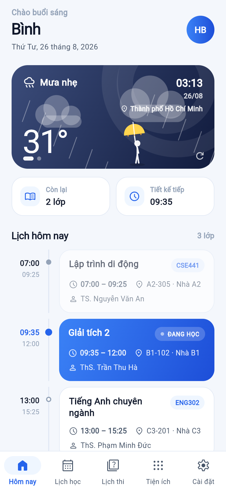
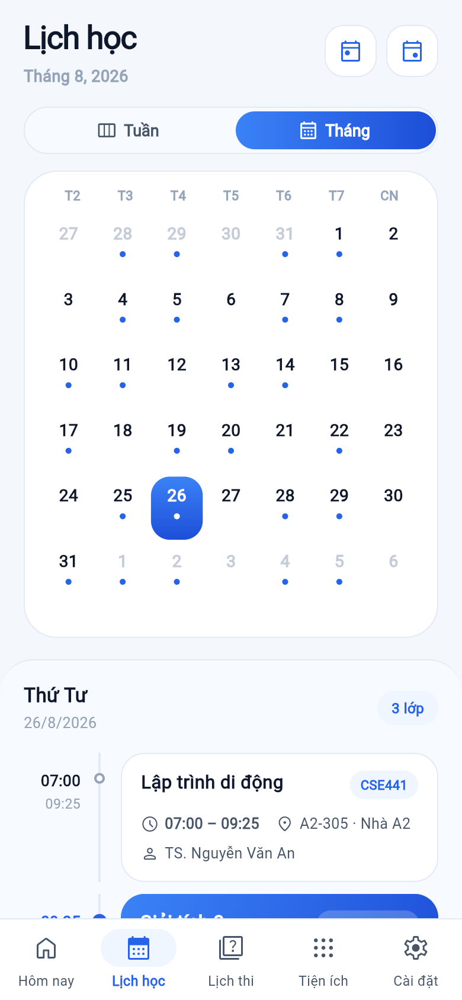

# TLU Study Planner

A modern Flutter application for TLU students to manage their study schedule, view course information, track exams, and access academic data.

> **Version 3.0** brings the liquid glass controls from `tlu_schedule_flutter`,
> exams in the daily agenda and calendar, live school announcements, and WeatherAPI.com.
> See [3.0 release notes](.github/release-notes/v3.0.0.md).

## Features

### Study & schedule

- **Calendar View** - View daily schedule with horizontal date picker
- **Course Management** - Track courses, credits, and subject marks
- **Exam Schedule** - Never miss an exam with notifications
- **Academic Records** - View grades and behavior marks
- **Smart Notifications** - Daily reminders at 6 AM
- **Dark Mode** - Automatic theme switching
- **Auto Data Sync** - Automatic refresh every 30 days
- **Offline Mode** - Cached data stays readable without a connection

### Notifications hub

Reached from the bell in the Home header, which shows an unread-mail badge.
Two pills split the page:

- **Thông báo** - live university announcements with skeleton loading and an in-app article viewer;
- **Mail** - the student's `@tlu.edu.vn` inbox, **read-only**.
  - **One-time sign-in** via OAuth 2.0 + PKCE in the system browser
  - **Refresh token in the platform keystore** (Android KeyStore / iOS Keychain),
    never in SharedPreferences; the access token stays in memory only
  - **Message cards** showing sender, subject, preview and time, with unread
    marked three ways - dot, bold title, tinted card - so the state survives
    colour blindness
  - **Message view** with attachments; tap to download via Graph and open in
    the system's own app
  - **New-mail notifications**, toggleable, checked while the app is open

The app requests `Mail.Read` only - it cannot send, reply, or delete.
Setup (Azure app registration) is documented in [`docs/mail_setup.md`](docs/mail_setup.md).

### Course registration *(new in 2.0)*

- **Register and drop classes** directly from the app during an open period
- **Three-level selector** - school year -> term -> registration period
  (Học kỳ chính, Học kỳ phụ, Tiếng Anh tăng cường, Học phần tốt nghiệp,
  Chuẩn đầu ra ngoại ngữ, Ôn thi Chuẩn đầu ra ngoại ngữ)
- **Live seat counts** with full classes blocked before the request is sent
- **Period window banner** showing whether registration is open and until when
- **Timetable preview** per class - weekday, periods, room, lecturer, week range
- **Schedule-clash warning** before registering an overlapping class
- **Confirmation on drop**, matching the portal's own behaviour

### Utilities hub *(redesigned in 2.0)*

- **Card grid** replacing the old scrolling tab row - every utility visible at once
- **Dedicated pages** for Điểm, Rèn luyện, Học phí, Chương trình đào tạo
- **Slide-up transitions** with a back button on each page

## What's new in 2.2

| Area | Change |
|---|---|
| Notifications | New hub - university mailbox over Microsoft Graph, read-only, with unread state and attachments |
| Home header | Avatar replaced by a bell with an unread badge. The avatar's only job was a shortcut to Settings, which already has its own tab |
| Secrets | The OpenWeather key left the source tree. All keys now come from `env.json` via `--dart-define-from-file` |
| Versioning | One source of truth - `pubspec.yaml`, surfaced through `lib/config/app_info.dart`. No more `'2.0.0'` typed into a screen |
| CI | Flutter pinned to 3.47.2 to match `pubspec.lock`, and `env.json` rebuilt from GitHub Secrets at build time |

## Versioning

The version number lives in **exactly one place**: the `version:` line in
`pubspec.yaml`. Flutter feeds it to `versionName` (Android) and
`CFBundleShortVersionString` (iOS), and `lib/config/app_info.dart` reads it
back at runtime, so the Settings screen and logs follow automatically.

`AppInfo.releaseDate` in that same file is the only other value to touch - a
release date has nowhere to live in `pubspec.yaml`.

```dart
AppInfo.version      // "2.2.0"      - from pubspec.yaml
AppInfo.buildNumber  // "2025110220" - Android versionCode / the +N in pubspec
AppInfo.releaseDate  // "04-09-2026" - the one constant edited by hand
AppInfo.fullVersion  // "2.2.0 (2025110220)"
```

Android's `versionCode` stays in `android/app/build.gradle.kts`. It is
deliberately separate: Play Store requires it to increase on every upload, and
users never see it.

## Requirements

- Flutter SDK: 3.47.2 or newer (Dart 3.12+)
- iOS: 18.0+
- Android: API level 24+ *(raised by flutter_appauth)*

## Getting Started

### Prerequisites

```bash
flutter doctor
```

### Installation

1. Clone the repository:
```bash
git clone https://github.com/Bintaplaptrinh/TLU-Study-Plan.git
cd TLU-Study-Plan
```

2. Create your API key file (see [Configuring API keys](#configuring-api-keys)):
```bash
cp env.example.json env.json
```

3. Install dependencies:
```bash
flutter pub get
```

4. Run the app:
```bash
flutter run --dart-define-from-file=env.json
```

In VS Code, press **F5** instead - `.vscode/launch.json` already passes the flag.

### Configuring API keys

No key is ever written into the source tree. They live in `env.json` at the
project root, which is **gitignored**, and reach the build through
`--dart-define-from-file`.

```json
{
  "WEATHER_API_KEY": "your-key-here",
  "TLU_MAIL_CLIENT_ID": "your-azure-client-id"
}
```

| Key | Needed for | Where to get it |
|---|---|---|
| `WEATHER_API_KEY` | Home weather card | <https://www.weatherapi.com/docs/> |
| `TLU_MAIL_CLIENT_ID` | Notifications -> Mail | Azure app registration, see [`docs/mail_setup.md`](docs/mail_setup.md) |

The app builds and runs with either key missing - only the feature that needs
it reports the gap, in plain Vietnamese. That is why `String.fromEnvironment`
is used rather than a gitignored `secrets.dart`: a missing file would break
compilation for anyone cloning the repo.

For CI, the same values are stored as GitHub Secrets under the same names; the
workflow rebuilds `env.json` from them before building.

### Tests

```bash
flutter test
```

## Building

### Android
```bash
flutter build apk --release --dart-define-from-file=env.json
```

Release signing reads `STORE_PASSWORD`, `KEY_ALIAS` and `KEY_PASSWORD` from the
environment and expects `rel.jks` at the project root. The keystore,
`local.properties` and `env.json` are all gitignored - never commit them.

### iOS
```bash
flutter build ios --release --dart-define-from-file=env.json
```

## Architecture

- **State Management**: Provider
- **Database**: SQLite (sqflite)
- **HTTP Client**: Dio
- **Local Storage**: SharedPreferences
- **Secure storage**: flutter_secure_storage (KeyStore / Keychain)
- **Notifications**: flutter_local_notifications
- **OAuth**: flutter_appauth (Authorization Code + PKCE)

### Project layout

```
lib/
  config/        Version index (app_info) and API keys (app_secrets, mail_config)
  models/        Data models and JSON parsing
  services/      Portal API clients, Graph mail, database, notifications
  providers/     App state (user, schedule, exams, enrollment, mail)
  screens/       Screens and page-level widgets
  widgets/       Shared UI components
  utils/         Helpers, page transitions
  i18n/          Runtime translation layer
```

## API Integration

### Education portal

The app connects to TLU's education portal at `https://sinhvien1.tlu.edu.vn/education` to fetch:
- Student information
- Semester courses
- Subject marks
- Behavior marks
- Tuition information
- Exam schedules
- Course registration data

Authentication uses OAuth2 password grant against `/oauth/token`; every
`/api/...` call carries the resulting bearer token.

### Microsoft Graph *(mailbox)*

`tlu.edu.vn` is a managed Microsoft 365 tenant, so the mailbox is read through
`https://graph.microsoft.com/v1.0`:

| Endpoint | Used for |
|---|---|
| `GET /me/mailFolders/inbox/messages` | message list (`$select` trimmed, `$top`/`$skip` paged) |
| `GET /me/messages/{id}` | full message body |
| `GET /me/messages/{id}/attachments` | attachment list |
| `GET /me/messages/{id}/attachments/{aid}/$value` | attachment bytes |
| `GET /me/mailFolders/inbox` | unread count for the badge |

Message bodies render in a WebView with **JavaScript disabled** and all
navigation blocked - mail is untrusted content.

### Notes on the registration API

The registration endpoints are only reachable while a period is open, so they
were traced against a live period rather than guessed. Three details cost real
debugging time and are worth knowing before touching that code:

- The write endpoints expect the **entire class object** returned by
  `findByPeriod` as the request body, not a trimmed payload.
- The period-level `isAllowUnRegister` flag reads `false` even when dropping a
  class succeeds. Gate the drop button on the per-subject
  `isAllowSubjectUnRegister` flag instead.
- Timetable entries carry `startDate` / `endDate` as epoch milliseconds;
  `fromWeekStr` / `toWeekStr` exist but are always null.

## Screenshots

<table>
  <tr>
    <td align="center" width="50%">
      
    </td>
    <td align="center" width="50%">
      
    </td>
  </tr>
</table>

## License

This project is private and intended for TLU students only.

## Version

Current version: **3.0.0** <br>
Release Date: **05/11/2026**
